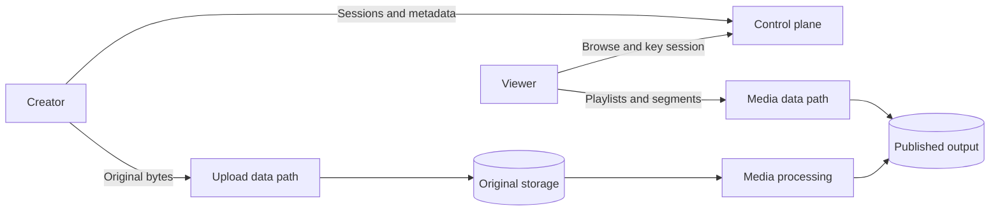
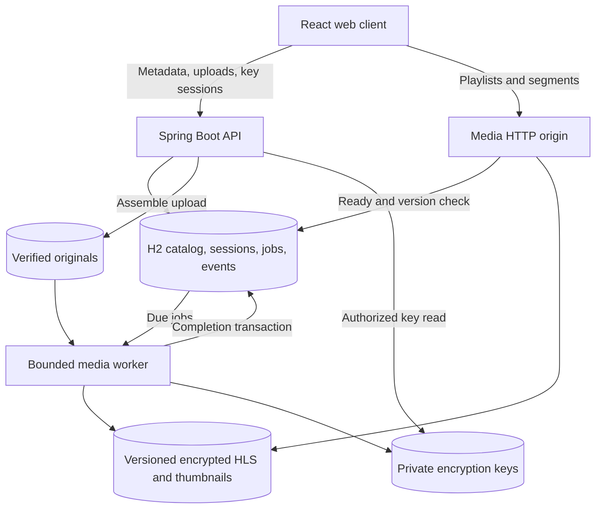

# Designing a video platform: from developer to architect

This is an architecture workshop for mid-level and senior developers. Use the working Frame application to connect design ideas to code, failure cases, measurements, and decisions you can defend in a review.

The starting point is the [Design YouTube chapter](https://github.com/desi109/cheat-sheets/blob/master/system-design/15-design-YouTube.md). This guide develops an original, project-specific learning path around its upload/streaming problem; it does not describe YouTube's actual internal architecture.

For installation and commands, use the [project README](../README.md). For architectural learning, follow these chapters:

| Chapter                                                                          | Main question                                               | Engineering output                                               |
| -------------------------------------------------------------------------------- | ----------------------------------------------------------- | ---------------------------------------------------------------- |
| [1. Requirements and capacity](architecture/01-requirements-and-capacity.md)     | What are we designing, and how big is the workload?         | Scope, invariants, capacity calculations, candidate SLOs         |
| [2. Components and data](architecture/02-components-and-data.md)                 | Who owns each fact and transition?                          | Component boundaries, ER diagram, state machines, schema choices |
| [3. Upload and processing](architecture/03-upload-and-processing.md)             | How does an unreliable request become a durable asset?      | Upload protocol, processing graph, crash/recovery reasoning      |
| [4. Playback and security](architecture/04-playback-and-security.md)             | How do bytes reach a player safely and smoothly?            | HLS examples, request sequence, cache and trust boundaries       |
| [5. Scaling and operations](architecture/05-scaling-and-operations.md)           | What changes when one machine stops being enough?           | Deployment design, claims/outbox examples, monitoring, runbooks  |
| [6. Build and architecture labs](architecture/06-build-and-architecture-labs.md) | How do I build this and demonstrate architectural judgment? | Vertical slices, experiments, ADRs, review exercises             |

Examples marked **current implementation** describe code in this repository. Examples marked **proposed** describe an evolved design or an exercise; they are not installed migrations or existing features.

## Develop architectural judgment

A useful design explanation connects five things: a requirement, the chosen mechanism, its consequences, supporting evidence, and a trigger for revisiting the decision.

For example, resumable upload prevents a lost connection from forcing a complete retransmission. Chunking supplies the mechanism, but introduces duplicate requests, assembly, expiration, and capability management. A reload/resume browser test supplies evidence. Excessive upload traffic through the Java server is a reason to revisit the design and introduce direct object-storage uploads.

You should leave this workshop able to derive a capacity model, define ownership and consistency rules, analyze failure windows, and propose incremental infrastructure changes. Naming more services is not sufficient: explain which measurable problem each additional service solves.

## Start with control traffic and media traffic

Metadata requests, original uploads, and long-running playback have different bandwidth and latency characteristics. The control plane decides what is allowed and tracks state. The data paths move the large payloads. They can share one executable initially while remaining separate architectural concepts.

## Current local implementation

## Boundaries

- `catalog`: ready-only metadata, paginated title/tag search, related-video selection, cache invalidation.
- `upload`: draft metadata, capability tickets, streamed checksum-validated chunks, original assembly, atomic queue insertion.
- `processing`: FFmpeg/ffprobe processes, fixed dependency graph, rendition planning, bounded scheduling, durable jobs, completion events.
- `playback`: signed playback sessions, private key access, allowlisted published media, MIME/range/cache behavior.
- `storage`: separate local locations for originals, temporary output, public output, and private material. No user-supplied filename becomes a storage path or shell command.

Java owns all APIs. Node/npm builds and tests the frontend and optionally provides local media-tool binaries. The main browser bundle loads watch/upload routes lazily; the HLS library is loaded for the watch route.

## Consistency and recovery

The default deployment is one process with a file-backed H2 database. In-process synchronization serializes upload mutations; unique chunk/job/event constraints provide a second line of protection. This is not a distributed locking strategy.

Chunk bytes are written to a temporary file and verified before a move and database acknowledgement. The storage helper attempts an atomic move but falls back to a regular move when unsupported; see the publication limitations in chapter 2. Retrying can replace the same verified chunk. Conflicting duplicates return 409. Completion checks the assembled original and commits the completed session, queued video, and unique job together. A retry reuses the same identities. Completed chunk files can then be discarded.

The fixed processing dependency graph is inspect → thumbnail/renditions → validate → publish → completion handler. One job runs at a time, with at most two media-tool subprocesses. Child processes are bounded by timeouts and terminated during interruption/shutdown. HTTP upload chunks are byte chunks; FFmpeg creates keyframe-aligned playback segments after assembly.

Each attempt has its own working directory, key, and deterministic output version. A filesystem move and database commit cannot be one transaction: a publication descriptor lets the worker discover output after a process interruption and complete metadata without re-encoding. The descriptor is excluded from HTTP serving. Keys are retained when publication succeeded but completion persistence failed. This recovery approach is not a guarantee of power-loss durability or distributed publication safety.

Completion events and the READY video/job update are idempotent. Retry/terminal video+job changes are transactional. Startup requeues abandoned RUNNING jobs, reconciles failed jobs, and drains pending completion events. Three total attempts handle recoverable processing errors; invalid media ends immediately. Originals remain available for retries.

H2 schema evolution uses Hibernate `ddl-auto=update` for this initial local project. Production evolution should use reviewed, versioned migrations instead.

## Media and session policy

Probe and encoding share a whitelist of self-contained input formats. Uploaded HLS/DASH/reference manifests cannot read other local media or bypass the original upload limit. FFmpeg inputs cannot use network protocols. Rotation and sample aspect ratio are normalized to display geometry before selecting renditions; outputs use square pixels and preserve that geometry.

Published version URLs are immutable. Media serving accepts only the selected video's published version and known manifest/segment/thumbnail filenames. It rejects traversal, symlink paths, private keys, originals, working output, and publication descriptors. Spring's resource serving supports HEAD, byte ranges (206), and invalid ranges (416).

Manifests use stable `/api/videos/{id}/key` URIs. The browser obtains a 15-minute signed HttpOnly, SameSite cookie scoped to that video's key route; active playback renews every five minutes. Keys/session responses use `no-store`. Per-video cookie paths support multiple videos/tabs independently. Persisted signing material preserves validity through routine restart. The local HTTP default omits Secure cookies; HTTPS deployment must require Secure cookies.

Public viewers can request ready-video sessions. Encryption here is a real delivery mechanism but does not authenticate viewers or prevent copying. Upload management capabilities are scoped to a single upload; there is no claim of signed-in uploader identity.

## API outline

- `GET /api/videos?q=&page=0&size=24`: ready-only catalog (page size 1–48).
- `GET /api/videos/{id}`, `GET /api/videos/{id}/related?limit=12`: watch metadata and related items.
- `POST /api/uploads`: draft/session creation with filename, sizeBytes, SHA-256, title, description, tags.
- `GET /api/uploads/{id}`: received indices and upload state using management bearer capability.
- `POST /api/uploads/{id}/ticket`: renew upload ticket using management capability.
- `PUT /api/uploads/{id}/chunks/{index}`: raw chunk body, ticket bearer, `X-Chunk-SHA256` header.
- `PATCH /api/uploads/{id}/metadata`: title/description/tags using management capability.
- `POST /api/uploads/{id}/complete`: validate/assemble/queue; idempotent response.
- `GET /api/uploads/{id}/video`: owner metadata, stage/status, structured processing error.
- `POST /api/videos/{id}/playback-session`: ready-only session; sets key cookie.
- `GET /api/videos/{id}/key`: exactly 16 key bytes with matching unexpired cookie.
- `GET /media/{id}/{version}/{assetPath}`: published allowlisted assets.

JSON errors contain `code`, `message`, and `requestId`. Validation/capability/state errors use 400/401/403/404/409/413 as appropriate; storage failures use 507. Asynchronously discovered unsupported/malformed media is reported through the video's processing state. Sensitive capabilities, private paths, and subprocess input are not returned in public errors.

## Deployment roadmap from the brief

The repository also publishes a **static GitHub Pages demo**. Its catalog and public sample films are prepared at build time; Java and FFmpeg are build dependencies, not services running on Pages. It demonstrates browsing and playback without exercising server-side upload, authorization, or recovery. The local application and the proposed service architecture below have different runtime responsibilities. See [Pages deployment](../README.md#github-pages-deployment) for the boundary and build commands.

Keep these changes separate from the local implementation:

1. Replace local original/output storage with object storage and direct pre-signed multipart uploads.
2. Replace H2 with PostgreSQL and versioned migrations; externalize worker claims/events through a broker or durable queue.
3. Run encoding workers separately from stateless API instances, with stage-level resource allocation, leases, retries, and a completion consumer.
4. Put encrypted immutable media behind an origin/CDN, keeping the key/session service separate. Coordinate CORS, cookies or signed key URLs, cache invalidation, and transport security.
5. Add account authentication, upload quotas, moderation/takedown, abuse controls, retention/deletion, monitoring, backups, and incident handling.
6. Validate with load tests before adding replicas, geographic upload regions, database replication/sharding, or popularity-based storage/CDN optimization.

The brief's five-million-DAU example and historical storage/egress estimates are design context, not demonstrated capacity or current cloud pricing. A single local filesystem and H2 process provides neither global delivery nor high availability.

## Read one user journey through the code

Follow one `videoId` through [UploadService](../backend/src/main/java/com/desi/youtube/upload/UploadService.java), [JobRunner](../backend/src/main/java/com/desi/youtube/processing/JobRunner.java), [ProcessingPipeline](../backend/src/main/java/com/desi/youtube/processing/ProcessingPipeline.java), [CompletionHandler](../backend/src/main/java/com/desi/youtube/processing/CompletionHandler.java), and [MediaController](../backend/src/main/java/com/desi/youtube/playback/MediaController.java). At every transition ask what is persisted, what can fail next, and who can retry safely.

Before the next chapter, explain two situations: the browser loses the upload-completion response; the encoder finishes while the database is unavailable. If your answer to both is only “retry,” identify the persistent identities and reconciliation behavior that make those retries safe.

[Continue: requirements and capacity](architecture/01-requirements-and-capacity.md)
