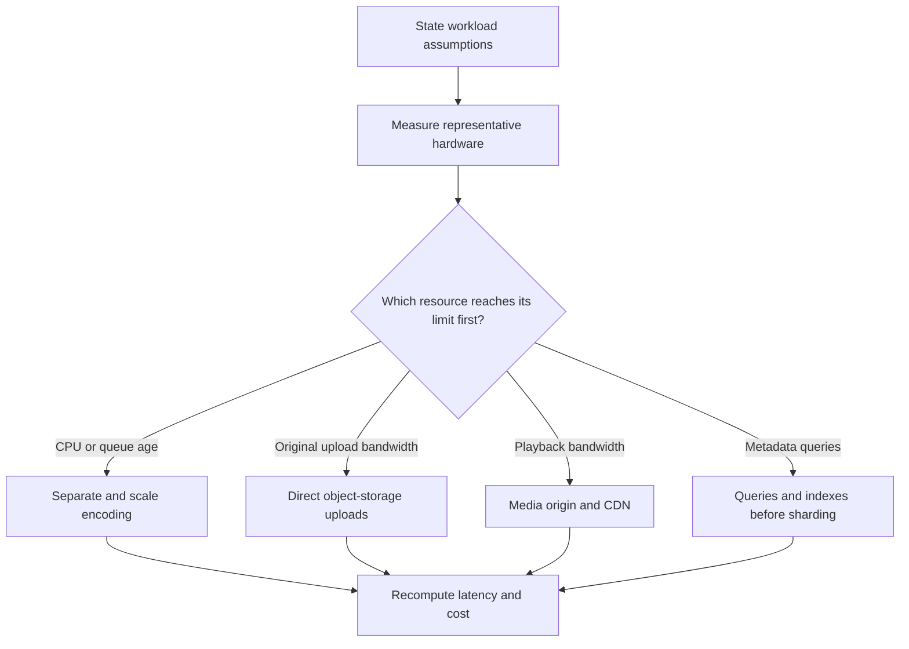

# 1. Requirements and capacity

[Guide](../architecture.md) · [Next: components and data](02-components-and-data.md)

## Establish a product boundary

“Build YouTube” is not a sufficiently precise requirement. This project implements recorded-video upload and viewing, plus the browse/search experience needed to find a video. Live broadcasting, billing, subscriptions, comments, recommendation models, takedown, and native TV/mobile clients are separate capabilities.

The [reference chapter](https://github.com/desi109/cheat-sheets/blob/master/system-design/15-design-YouTube.md) motivates a much larger upload/streaming service. Here, its workload assumptions are a design exercise. The application is a local implementation of the core flows, not a validated implementation of that scale.

Ask questions that change the design:

- Must playback begin during upload/encoding? This project waits for complete publication; progressive publication changes the contract.
- Are videos public, shared, private, or paid? Public key-session issuance cannot enforce private entitlements.
- What is the longest duration and maximum original size? Bytes alone do not bound decode complexity or encoding time.
- Does resume work within a tab, after reload, across devices, or after days offline?
- How quickly must an uploaded video become watchable? This affects queue capacity and possibly which rendition is published first.
- What loss is acceptable after disk or region failure? Process-restart recovery and disaster recovery are different requirements.

## Make the current contract concrete

The maximum original is **1,000,000,000 bytes**. Upload chunks are 8,388,608 bytes except the last, with at most two browser requests in flight. SHA-256 identifies the entire file and validates individual chunks. Incomplete sessions expire after 24 hours without activity; upload tickets last 15 minutes.

After completion, processing inspects the source and creates source-appropriate renditions. Landscape ceilings are 640×360, 1280×720, and 1920×1080; portrait ceilings are transposed. Smaller inputs are not upscaled to invent detail. H.264/AAC output becomes AES-128 encrypted MPEG-TS HLS; silent input remains silent.

“100% uploaded” means acknowledged original bytes reached storage. It does not mean encoding has finished. The UI therefore distinguishes byte progress from processing state.

## Invariants

An invariant should survive retries, concurrency, and interruption:

1. A public catalog result refers only to a `READY` video.
2. Repeating completion of one upload does not create another job or video.
3. A conflicting duplicate chunk cannot silently replace acknowledged different content.
4. `READY` requires the selected publication's playable output and key reference.
5. Private keys are never publicly served static files.
6. Retry cleanup must not delete a key referenced by already-published output.
7. A terminal job outcome must eventually agree with the owner-visible video outcome.

These statements drive transaction boundaries and failure tests. A UI happy-path test cannot establish them all.

## Define service goals before infrastructure

These are **proposed learning targets**, not implemented monitoring or measured guarantees. Include hardware, network, source duration, and the success definition in each experiment.

| Journey           | Indicator                           | Example controlled-lab target                                   |
| ----------------- | ----------------------------------- | --------------------------------------------------------------- |
| Browse            | Successful request latency          | p95 below 500 ms at a stated catalog size                       |
| Start playback    | Play action to first decoded frame  | p95 below 3 s on a specified 10 Mbit/s link                     |
| Continue playback | Stalled time / active playback time | Below 1% over the test cohort                                   |
| Process           | Completion accepted to `READY`      | p95 below 120 s for clips up to 60 s at 720p on stated hardware |
| Recover           | Restart to reconciled outcome       | Explicit timeout and no duplicate publication                   |

Measure failures too. Latency that excludes every failed playback attempt can make an unusable player look healthy. Include queue waiting time when reporting the delay experienced by a creator.

## Capacity model

Use the chapter's illustrative inputs: 5 million daily users, 30 minutes watched per user per day, 10% uploading one video daily, and a 300 MB original. Add explicit assumptions: average delivered bitrate 3 Mbit/s and a three-times peak factor. These are hypothetical values, not observations from this application or current YouTube statistics.

Use decimal units: MB = 10⁶ bytes, GB = 10⁹ bytes, TB = 10¹² bytes. The chunk unit is MiB = 2²⁰ bytes.

### Ingestion and storage

```text
uploads/day       = 5,000,000 × 0.10                  = 500,000
average arrivals  = 500,000 / 86,400                 ≈ 5.79 uploads/s
original bytes    = 500,000 × 300,000,000            = 150 TB/day
30-day originals  = 150 TB/day × 30                  = 4.5 PB
```

This excludes encoded output, replicas, backups, temporary files, and retries. If measured encoded output averages 1.5 times original size, originals plus encoded output add 375 TB/day before those extra factors. That factor is an assumption to replace with measurements, not an inherent HLS property.

### Viewing traffic

```text
viewer-seconds/day     = 5,000,000 × 30 × 60          = 9,000,000,000
average concurrency   = 9,000,000,000 / 86,400       ≈ 104,167 viewers
peak concurrency      = average × 3                 ≈ 312,500 viewers
average bandwidth     = 104,167 × 3 Mbit/s           ≈ 312.5 Gbit/s
peak bandwidth        = 312,500 × 3 Mbit/s           ≈ 937.5 Gbit/s
daily delivered bytes = 9,000,000,000 × 3,000,000 / 8 = 3.375 PB/day
```

With four-second segments, approximate peak segment traffic is 312,500 / 4 = **78,125 requests/s**. This assumes one multiplexed audio/video rendition per viewer, excluding startup, playlists, retries, and quality changes. Separate audio tracks change the request count.

Do not multiply viewing bandwidth by the number of stored renditions. A player normally selects one rendition for each interval. Three stored qualities increase processing/storage, not steady-state viewing bandwidth threefold.

### Encoding

Suppose a benchmark measures **180 CPU-seconds per upload**, summed across all processing tasks:

```text
500,000 × 180 CPU-seconds / 86,400 ≈ 1,042 cores continuously busy
capacity at 70% utilization       ≈ 1,489 cores
```

This is a hypothetical resource budget, not a recommendation to provision that hardware. Wall-clock encoding seconds are not CPU-seconds when processes use multiple threads. GPU encoding needs its own measured throughput model. Peaks either need more capacity or increase queue waiting time; decide which user outcome is acceptable.

### Temporary working set

Estimate it from simultaneous jobs and their per-job working sets, then add incomplete uploads and retry leftovers. An original can coexist with both working and published output. A 1 GB upload limit therefore does not imply 1 GB of required free disk.

For a stable queue, Little's law relates average jobs in the system, arrival rate, and time: `L = λW`. If sustained arrival rate exceeds service capacity, there is no finite steady-state waiting time for that overloaded configuration.

## Let evidence identify the bottleneck



The laptop may first expose encoder CPU limits; the hypothetical large workload exposes media-delivery bandwidth. Increasing Java's HTTP thread count does not solve either by itself.

## Cost model

```text
storage    = average retained GB × storage price
delivery   = delivered GB × delivery price + request charges
encoding   = measured resource time × resource price
operations = databases + queues + observability + backups + engineering effort
```

A CDN hit can reduce origin requests/egress while viewer delivery still incurs charges. Byte hit ratio is more useful for bandwidth cost than request hit ratio when object sizes differ. Consult current regional pricing when estimating; do not reuse historical chapter prices as current quotes.

## Architecture exercise

Change delivered bitrate from 3 to 6 Mbit/s and peak factor from 3 to 5. Recompute bandwidth and segment requests. Explain why bitrate changes bandwidth but not the segment count under this model. Then halve the encoding CPU cost and identify which costs improve and which do not. Record what assumptions would invalidate your conclusions.
