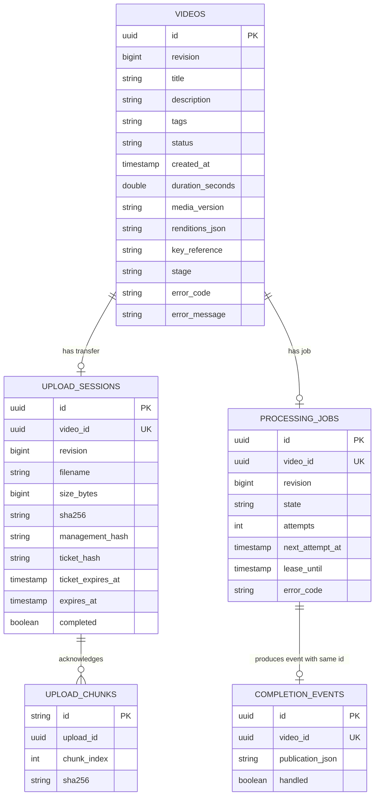
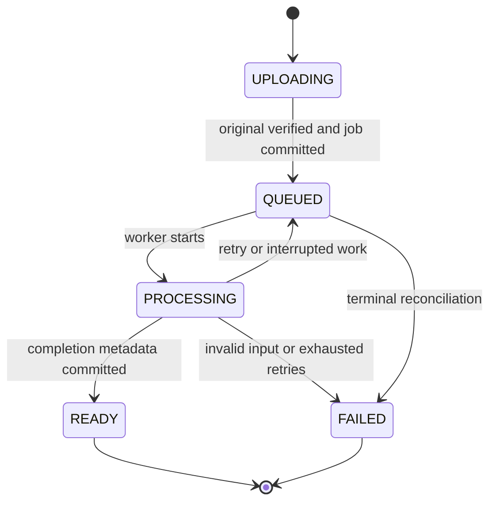
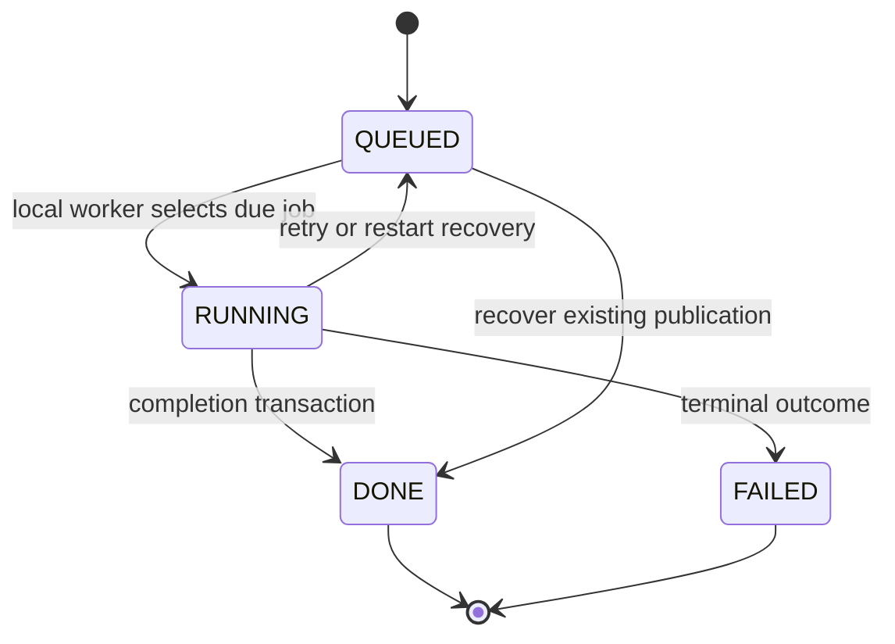

# 2. Components, ownership, and data

[Guide](../architecture.md) · [Previous](01-requirements-and-capacity.md) · [Next: upload and processing](03-upload-and-processing.md)

## Choose boundaries around responsibilities

Start with a modular monolith to verify one complete workflow. Still distinguish metadata, transfer management, processing, publication, and delivery. A future service extraction should cross an already-understood contract.

| Module       | Owns                                                | Should not own                         |
| ------------ | --------------------------------------------------- | -------------------------------------- |
| `catalog`    | Ready-video metadata and discovery                  | Video payloads inside DTOs             |
| `upload`     | Sessions, capabilities, chunks, assembled originals | Encoding inside the completion request |
| `processing` | Inspection, encoding, jobs, publication             | Browser state or viewer identity       |
| `playback`   | Sessions, key checks, media delivery                | Original chunk acknowledgement         |
| `storage`    | Storage locations and containment                   | Subscription/entitlement decisions     |

These are current package boundaries, not independent bounded contexts: services share repositories and the H2 transaction manager. Extracting services requires explicit data ownership and new contracts, not just separate containers.

Only the completion path should make a processed video public. If arbitrary controllers can set `READY`, the publication invariant becomes difficult to enforce.

## Separate identity from location

```text
videoId             the catalog item
uploadId            its resumable transfer
jobId               its processing work
publicationVersion  one immutable encoded output
```

A supplied filename is metadata, not a trusted path. `/media/{videoId}/{version}/720p/segment-00000.ts` distinguishes a business entity from a particular artifact. Future re-encoding can create another version without overwriting cached bytes. Retiring old versions is a separate retention decision.

## Current logical schema



These arrows show **logical relationships**, not database foreign keys installed by the current entities. Plain UUID fields do not create foreign keys. The JPA entities define IDs, selected uniqueness constraints, and optimistic revisions; services/transactions enforce additional consistency.

Read [Video](../../backend/src/main/java/com/desi/youtube/catalog/Video.java), [UploadSession](../../backend/src/main/java/com/desi/youtube/upload/UploadSession.java), [UploadChunk](../../backend/src/main/java/com/desi/youtube/upload/UploadChunk.java), [ProcessingJob](../../backend/src/main/java/com/desi/youtube/processing/ProcessingJob.java), and [CompletionEvent](../../backend/src/main/java/com/desi/youtube/processing/CompletionEvent.java).

The unique `(upload_id, chunk_index)` constraint prevents duplicate acknowledgements at one position. Unique job `video_id` expresses one processing job per video in this version. Event ID equals job ID, giving completion a stable deduplication identity. Retry increments the existing job's attempts.

After assembly, chunk files can be discarded because the verified original is authoritative. The acknowledgement rows can remain; their retention is a separate policy from temporary-file cleanup.

### Denormalized metadata

Tags are comma-separated text and renditions are JSON text in the current entity. This simplifies the small application but limits queryability and relational checks. Search is substring matching, not a search index. Related-video selection ranks a bounded set of recent candidates, not the entire catalog.

Normalize tags when exact membership and tag analytics matter. A rendition table can enforce uniqueness by video/version/quality and support codec evolution. Select a search design after specifying ranking, language support, index freshness, and expected query volume.

## Video and job states describe different things



Expired incomplete sessions are cleaned up with their drafts, rather than becoming a new `EXPIRED` video state. A failed source needs a new upload in the present UI; there is no existing manual retry endpoint.



The direct recovery route matters: encoding may have finished before a crash prevented ready metadata from committing. Re-encoding would waste resources and risk another publication.

## Database facts versus large payloads

Store identities, state, expected size/hash, acknowledgements, attempts, selected publication version, and relative private references in the database. Large video payloads belong in media storage. UI stage text is useful to people; structured states/error codes should drive decisions.

```text
data/
  database/                         H2 files
  chunks/{uploadId}/{index}.chunk    partial originals
  originals/{videoId}/source         verified source
  working/{jobId}/{attempt}/         unpublished artifacts
  published/{videoId}/{version}/
    master.m3u8
    thumbnail.jpg
    360p/index.m3u8
    360p/segment-00000.ts
    publication.json                recovery metadata; HTTP access forbidden
  private/{jobId}/{attempt}.key      encryption key; never a static asset
  private/playback-signing.key       session signing material
```

The recovery descriptor sits in the output directory but is excluded by the HTTP allowlist. Filesystem location and HTTP exposure are distinct policies.

## Proposed PostgreSQL schema fragment

This is **a teaching example, not the installed H2 schema or a complete migration**. Add remaining columns, backfill/rollout rules, and appropriate indexes before adopting it.

```sql
CREATE TABLE videos (
    id uuid PRIMARY KEY,
    status text NOT NULL CHECK (
        status IN ('UPLOADING', 'QUEUED', 'PROCESSING', 'READY', 'FAILED')
    ),
    title varchar(200) NOT NULL,
    created_at timestamptz NOT NULL,
    revision bigint NOT NULL DEFAULT 0
);

CREATE TABLE upload_sessions (
    id uuid PRIMARY KEY,
    video_id uuid NOT NULL UNIQUE REFERENCES videos(id),
    size_bytes bigint NOT NULL CHECK (size_bytes BETWEEN 1 AND 1000000000),
    sha256 char(64) NOT NULL,
    completed boolean NOT NULL DEFAULT false
);

CREATE TABLE upload_chunks (
    upload_id uuid NOT NULL REFERENCES upload_sessions(id),
    chunk_index integer NOT NULL CHECK (chunk_index >= 0),
    sha256 char(64) NOT NULL,
    PRIMARY KEY (upload_id, chunk_index)
);

CREATE INDEX ready_catalog_order ON videos (created_at DESC, id ASC)
    WHERE status = 'READY';
```

This index supports an ordered ready-only access path, not an arbitrary `LIKE '%term%'` search. Explain the query and write/storage cost behind every index.

A future pagination cursor can include date and ID for deterministic ties. With date descending and ID ascending, the next-page predicate is `created_at < :time OR (created_at = :time AND id > :id)`. A tuple comparison copied without considering the mixed directions can skip or repeat results.

## Transaction boundaries

Upload completion commits the completed session, queued video, and unique job together, after expensive assembly. Completion handling commits the ready version, rendition/key metadata, `DONE` job, and handled event together. Cache invalidation follows.

Files are outside those transactions. The descriptor helps reconcile the filesystem/database gap; it does not make them one atomic resource. The storage helper attempts an atomic move but falls back to a regular move if unsupported. Stronger publication requires known filesystem guarantees or immutable object keys plus a completion marker and a conditional metadata pointer. Power-loss durability additionally requires storage/database durability analysis.

## Architecture exercise

Design re-encoding to a second codec while the old version remains playable. Which uniqueness rules change? How is the current publication selected? How is a late old job rejected? When can old output and keys be deleted? Replace each existing business constraint with an explicit new one rather than simply dropping constraints.
