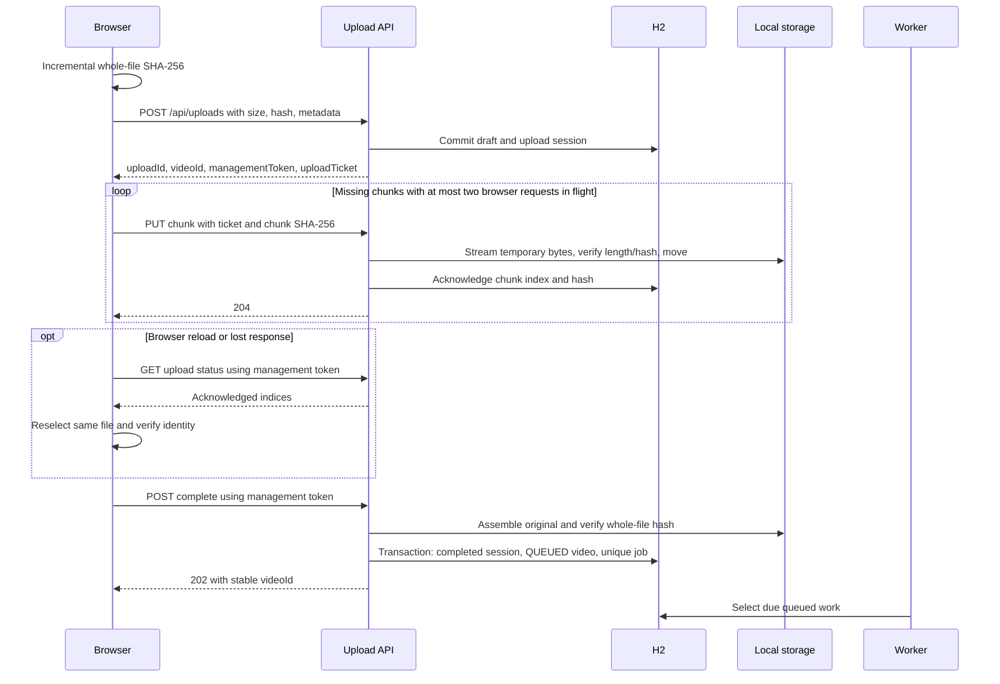
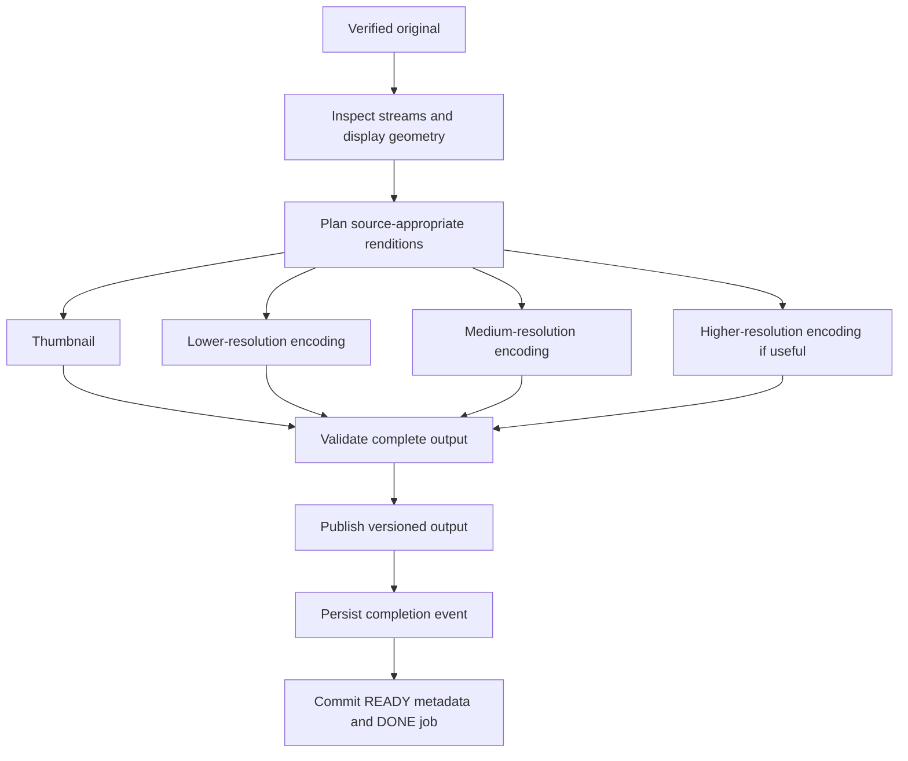
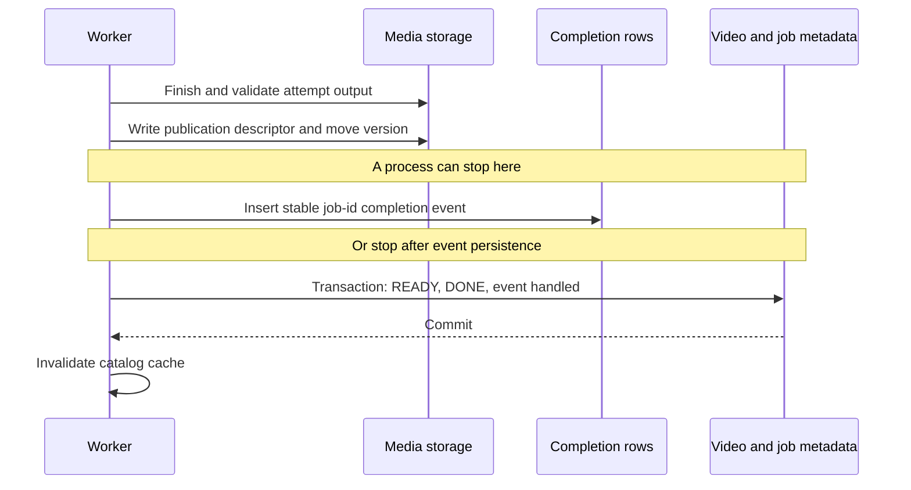

# 3. Upload, processing, and publication

[Guide](../architecture.md) · [Previous](02-components-and-data.md) · [Next: playback and security](04-playback-and-security.md)

## Why upload is a protocol, not one POST

Networks interrupt requests, responses can be lost after success, tabs reload, and users select the wrong file when resuming. A durable transfer needs an identity and a way to ask the server which work is already acknowledged.

The server must validate actual bytes, not just a browser's declaration. A size field cannot prevent an oversized request body. A filename/MIME type cannot establish that a file contains valid, self-contained video. Byte-level checks happen during transfer; media inspection happens before encoding.

## Current upload sequence



Current code uses synchronized service methods, so the server serializes upload mutations within this instance even though the browser can have two requests in flight. Neither synchronization nor the browser limit coordinates independent backend instances.

### Two capabilities with different purposes

The management token can inspect/resume a session, update metadata, renew its upload ticket, and complete it. The short-lived ticket can submit chunks for that upload. Random capability values are stored hashed on the server. Ticket renewal replaces the stored ticket; concurrent requests may therefore need a retry with the renewed ticket.

Issuance is public in this local application. This is transfer-scoped authorization, not proof of a signed-in creator. In a production design, authenticate the creator before issuing the capability and enforce ownership, quotas, and retention separately.

### HTTP examples

This is an illustrative request/response pair; IDs and capability values below are placeholders, not working credentials. Actual file and chunk hashes must match their corresponding bytes.

```http
POST /api/uploads
Content-Type: application/json

{
  "filename": "walk.mp4",
  "sizeBytes": 20000000,
  "sha256": "<64 hexadecimal characters computed from the whole file>",
  "title": "An evening walk",
  "description": "Light and movement in the city.",
  "tags": ["travel", "film"]
}
```

```json
{
  "uploadId": "11111111-1111-4111-8111-111111111111",
  "videoId": "22222222-2222-4222-8222-222222222222",
  "managementToken": "<private transfer-management capability>",
  "uploadTicket": "<short-lived chunk capability>",
  "chunkSize": 8388608,
  "ticketExpiresAt": "<server-provided expiration>"
}
```

For a 20,000,000-byte source, indices 0 and 1 contain 8,388,608 bytes each; index 2 contains 3,222,784 bytes. The original does not need to be allocated as one Java byte array.

```http
PUT /api/uploads/{uploadId}/chunks/0
Authorization: Bearer <uploadTicket>
X-Chunk-SHA256: <SHA-256 of this chunk only>
Content-Type: application/octet-stream

<raw chunk bytes>
```

Useful outcomes include 204 for an accepted or identical repeated chunk; 409 for conflicting content; 413 when the actual payload exceeds the allowed length; 400 for invalid checksum/index; and 401 for a missing/expired capability. A lost 204 response is harmless when the retried operation is genuinely idempotent.

## Distinguish byte chunks from playback segments

Upload chunks are byte ranges of an arbitrary original container. They need not begin with a decodable video frame. HLS segments are generated later by FFmpeg, aligned to suitable video boundaries. Treating byte chunks as independently playable video would fail for many formats and keyframe layouts.

In the browser, incremental hashing runs in a worker to avoid blocking the UI or reading a gigabyte at once. Upload progress counts server acknowledgements, not bytes merely passed to `fetch`. Cancellation must stop/drain sibling requests before a new upload run can begin; otherwise a “paused” UI can still send bytes in the background.

Source: [browser upload hook](../../frontend/src/hooks/useChunkedUpload.ts), [bounded chunk workers](../../frontend/src/api/uploadChunks.ts), and [upload service](../../backend/src/main/java/com/desi/youtube/upload/UploadService.java).

## Fixed processing graph



Edges show dependencies, not unlimited parallelism. The implementation has one video job at a time and two subprocess slots. A generic configurable DAG scheduler is a later extension when real workflow variation justifies it.

### Inspection and rendition planning

Inspect video presence, duration, audio presence, frame rate, rotation, and sample aspect ratio. Coded dimensions can differ from displayed dimensions. A 720×576 frame with sample aspect ratio 16:15 displays at 768×576, or 4:3. Scaling coded dimensions and then forcing square pixels would squash it.

Normalize display geometry before applying rotation and rendition ceilings. Plan even output dimensions for the selected encoding format, preserve the display ratio, deduplicate equivalent outputs, and avoid upscaling small sources. Reject unsupported/reference-based inputs before processing can read arbitrary local or network resources.

Current implementation: [MediaProbe](../../backend/src/main/java/com/desi/youtube/processing/MediaProbe.java), [RenditionPlanner](../../backend/src/main/java/com/desi/youtube/processing/RenditionPlanner.java), and [input policy](../../backend/src/main/java/com/desi/youtube/processing/MediaInputPolicy.java).

### An encoding fragment

This shell example creates one **unencrypted, trusted-fixture learning rendition**, not the application's entire publishing pipeline. Run from the project root after `npm ci`. The complete application adds input restrictions, keys, timeouts, multiple renditions, validation, and publication recovery.

```sh
MEDIA_LAB_DIR="$(mktemp -d)"
node scripts/create-test-video.mjs "$MEDIA_LAB_DIR/source.mp4"
FFMPEG_PATH="$(node -p "require('@ffmpeg-installer/ffmpeg').path")"

"$FFMPEG_PATH" -y -v error -i "$MEDIA_LAB_DIR/source.mp4" \
  -map 0:v:0 -map '0:a:0?' \
  -vf 'scale=640:360,setsar=1' -r 24 \
  -c:v libx264 -preset veryfast -pix_fmt yuv420p \
  -b:v 800k -maxrate 800k -bufsize 1600k \
  -flags +cgop -sc_threshold 0 -force_key_frames 'expr:gte(t,n_forced*4)' \
  -c:a aac -b:a 128k -f hls -hls_time 4 -hls_playlist_type vod \
  -hls_flags independent_segments \
  -hls_segment_filename "$MEDIA_LAB_DIR/segment-%05d.ts" \
  "$MEDIA_LAB_DIR/index.m3u8"
```

The dimensions/frame rate above are appropriate for the generated fixture, not arbitrary user media. Corresponding rendition timelines/keyframes must line up for useful switching. A target segment duration does not mean every segment has exactly that duration; inspect the actual manifests and decoded output. Consult the [FFmpeg HLS muxer documentation](https://www.ffmpeg.org/ffmpeg-formats.html#hls-1) when choosing flags.

The application's encrypted path writes a private key-info file with an authorized key URI and a private key-file path, and supplies it through `-hls_key_info_file`. See [FfmpegTranscoder](../../backend/src/main/java/com/desi/youtube/processing/FfmpegTranscoder.java). It uses the same key for the renditions of an attempt; encoding/key-rotation policy is a separate design concern when evolving the format.

## The filesystem/database publication gap



The descriptor records the selected version, renditions, duration, and private key reference. Version identity is deterministic from job ID and attempt. On restart the worker can discover a completed publication and finish metadata without re-encoding.

The event row is a durable local completion record. It is **not already a complete broker-based transactional outbox**. Object/file publication still occurs outside the metadata transaction; the descriptor and reconciliation are essential.

## Failure analysis

| Interruption or error                          | Required outcome                                  | Mechanism here or remaining limit                   |
| ---------------------------------------------- | ------------------------------------------------- | --------------------------------------------------- |
| Chunk stored before acknowledgement row        | Safe resend and acknowledgement                   | Temporary move plus repeated checksum validation    |
| Completion committed but response lost         | Same video/job on retry                           | Completed session and unique job identity           |
| Original moved before queue transaction        | A completion retry can assemble/requeue           | Retained chunk files until successful completion    |
| One rendition fails                            | No partial READY publication                      | Attempt-local working output and validation         |
| Output published before event insert           | Recover descriptor and persist completion         | Deterministic version lookup                        |
| Completion event delivered repeatedly          | One intended metadata result                      | Stable event ID and handled state                   |
| Completion persistence fails after publication | Retain output's key                               | Cleanup checks for an existing publication          |
| Process stops during encoding                  | Work can be reclaimed after restart               | Startup reconciliation in the single-instance model |
| Power loss or unsupported atomic move          | Requires stronger durability/publication analysis | Not established by existing process-restart tests   |

Transient media errors have up to three encoding attempts with delays of 5 and then 30 seconds. Invalid input terminates immediately. In a distributed design, add jitter, explicit retry classes, poison-message handling, and operations for intervention. Completion redelivery must remain idempotent; do not assume its delivery count is identical to the encoding attempt count.

## Why process limits matter

Java request threads are not the encoder capacity. Every FFmpeg process can use several threads and significant memory. Bound job concurrency, subprocess count, process duration, log size, temporary storage, and shutdown behavior. A timeout must terminate child processes; abandoning a Java future does not necessarily stop the native encoder.

Current [ProcessExecutor](../../backend/src/main/java/com/desi/youtube/processing/ProcessExecutor.java) caps subprocess slots and terminates children on timeout/interruption. A production worker should additionally run with OS/container resource limits and restricted access to storage and networks.

## Architecture exercise

Design publication of 360p before 720p completes. Decide whether `READY` means one playable rendition or all planned renditions. Define manifest versioning, player refresh, partially failed higher qualities, key lifetime, and the event contract. Explain how your design avoids advertising a segment that is still being written.
