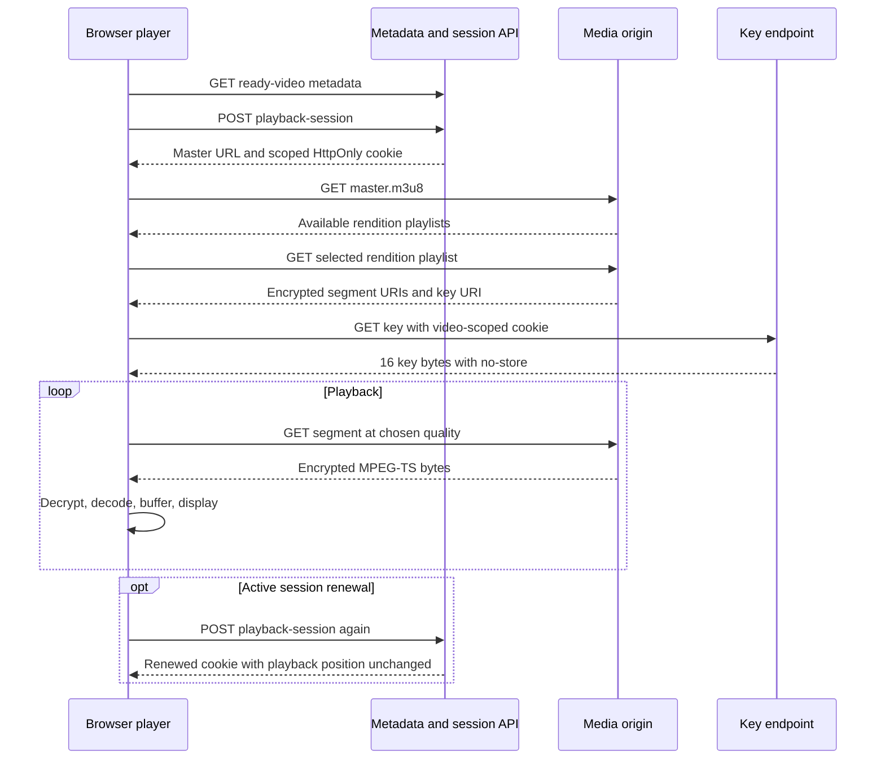

# 4. Playback, caching, and security

[Guide](../architecture.md) · [Previous](03-upload-and-processing.md) · [Next: scaling and operations](05-scaling-and-operations.md)

## Follow a watch session



Metadata is not the media payload. The player fetches a playlist, chooses a rendition, and retrieves a sequence of segments. It need not download the entire original before starting.

## Read the playlists

For a 720p source with audio, a simplified master resembles:

```m3u8
#EXTM3U
#EXT-X-VERSION:3
#EXT-X-INDEPENDENT-SEGMENTS
#EXT-X-STREAM-INF:BANDWIDTH=928000,RESOLUTION=640x360
360p/index.m3u8
#EXT-X-STREAM-INF:BANDWIDTH=2928000,RESOLUTION=1280x720
720p/index.m3u8
```

This example follows the current code's configured video targets plus 128,000 bit/s for audio. It illustrates the generated format, not a measurement of actual peak segment bitrate. When hardening the packaging ladder, measure actual rates and ensure bandwidth declarations represent the chosen HLS contract.

One rendition playlist might resemble:

```m3u8
#EXTM3U
#EXT-X-VERSION:3
#EXT-X-TARGETDURATION:4
#EXT-X-MEDIA-SEQUENCE:0
#EXT-X-PLAYLIST-TYPE:VOD
#EXT-X-KEY:METHOD=AES-128,URI="/api/videos/22222222-2222-4222-8222-222222222222/key"
#EXTINF:4.000,
segment-00000.ts
#EXTINF:2.000,
segment-00001.ts
#EXT-X-ENDLIST
```

Actual durations and optional IV declarations vary with encoder output. Relative playlist/segment paths resolve against the URL containing them. HLS AES-128 uses a 16-byte key; when identity-key encryption omits an explicit IV, the protocol defines an IV derived from the media sequence number. Use a compliant player or tested decryption implementation rather than guessing those rules. See [RFC 8216](https://datatracker.ietf.org/doc/html/rfc8216#section-4.3.2.4).

## Adaptive and manual quality

Auto selection should react to estimated bandwidth and buffer health. Selecting the highest source resolution unconditionally can cause stalls. Switching requires timeline/keyframe compatibility across renditions; otherwise changing a URL cannot magically preserve a continuous viewing experience.

The current [VideoPlayer](../../frontend/src/components/VideoPlayer.tsx) uses native HLS where available and hls.js otherwise. The hls.js path sets the selected level. Native manual switching changes the variant source and restores time/play state after metadata is loaded; Auto restores the master. The selector uses actual returned rendition metadata, including source-sized or portrait results.

Session renewal should update authorization without replacing the player source or resetting time. Test long-running playback, pause beyond expiration followed by resume, network recovery, teardown, and quality selection separately. Component tests can exercise the native branch; they are not evidence of real Safari decoding.

## Three independent security questions

**Authentication:** who is making the request?

**Authorization:** may this caller access this video's metadata, bytes, or keys?

**Encryption:** what transformations protect the media in storage/delivery, and who can decrypt it?

The local app does not authenticate accounts. Ready videos are public; any viewer can request a playback session. A signed cookie proves a valid video-scoped session, not a paid entitlement. AES-HLS is not commercial DRM and cannot stop an authorized viewer retaining a key or recording playback.

Session signatures use HMAC-SHA256 over the payload and expiration. HMAC authenticates the session token; AES encrypts the media. These are different keys and responsibilities.

## Cache policy is part of the security design

| Resource                           | Current response policy             | Reason and limit                                                                            |
| ---------------------------------- | ----------------------------------- | ------------------------------------------------------------------------------------------- |
| Versioned master/variant playlists | Public, immutable, one-year max-age | Content does not contain expiring bearer credentials; selected version is checked at origin |
| Encrypted versioned segments       | Public, immutable, one-year max-age | Same URL should return the same bytes                                                       |
| Thumbnail                          | Public, immutable, versioned        | Safe only for this application's public-video model                                         |
| Key/session responses              | `Cache-Control: no-store`           | Shared caches must not distribute authorization-sensitive responses                         |
| Ready-video DTO                    | Bounded server-side Caffeine cache  | Metadata convenience; not a general entitlement cache                                       |

The key URI is stable while the cookie expires. Embedding a short-lived token in an immutable stored manifest would make the manifest stale as soon as that token expired.

Current key cookies are HttpOnly, SameSite, video-path scoped, and expire after 15 minutes. Per-video paths support separate videos/tabs without one cookie replacing all others. Signing material is persisted locally across routine restarts. HTTPS deployments must use Secure cookies and define cross-origin/CDN credential behavior explicitly.

Origin authorization and CDN cache authorization are not interchangeable. Once a CDN caches public media, it might serve a hit without querying the application. Private-video designs must choose authorization at the edge or signed URLs/cookies with suitable cache-key rules. Public thumbnails may also leak private content even when segments are encrypted.

## Inspect HTTP delivery in this application

With a running backend, obtain a real ready video's `thumbnailUrl` and rendition playlist URLs from `/api/videos`. Replace the sample IDs below with those returned values.

```sh
curl -i 'http://127.0.0.1:8080/api/videos?page=0&size=24'
curl -I 'http://127.0.0.1:8080/media/VIDEO_ID/VERSION/thumbnail.jpg'
curl -i -H 'Range: bytes=0-187' \
  'http://127.0.0.1:8080/media/VIDEO_ID/VERSION/360p/segment-00000.ts'
```

Expect appropriate MIME types, HEAD without a response body, 206 for a satisfiable range, and 416 for an unsatisfiable range. The TS sample is encrypted; arbitrary 188-byte encrypted ranges are not independently decodable MPEG-TS packets. Do not infer codec correctness from a successful range response.

Spring's resource converters provide range handling through [MediaController](../../backend/src/main/java/com/desi/youtube/playback/MediaController.java). [PublishedAssetResolver](../../backend/src/main/java/com/desi/youtube/playback/PublishedAssetResolver.java) first checks ready state, selected version, the asset allowlist, path containment, and file existence. A successful UUID parse alone is not access control.

For a complete authorized-key and decryption experiment, run from the project root:

```sh
node scripts/smoke-test.mjs http://127.0.0.1:8080
```

It uploads a fixture, obtains the session cookie, validates key length, rejects anonymous key access, and decrypts an actual segment. It creates a real test item in the local library; use an isolated `DATA_DIR` for disposable experiments.

## Threats that change the architecture

An uploaded manifest can reference another local file or a remote URL even when its own byte size is tiny. Therefore the current probe/transcoder share a whitelist of self-contained containers and restrict input protocols. Extension checks alone cannot provide that protection.

Path traversal and symlink escape concern storage resolution; shell interpolation concerns process launching; oversized bodies concern streamed length enforcement. These need different controls. Use UUID-derived paths and literal process argument lists, avoid public private-key roots, and restrict worker access to only the resources it needs.

Capabilities stored in browser local storage survive reload, but same-origin script compromise can expose them. Account authentication, a content security policy, abuse controls, malware/decoder isolation, and least-privilege worker deployment are additional production concerns. They are not supplied by the local ticket mechanism.

## Revocation and takedown exercise

Imagine a video must become inaccessible within 30 seconds. Consider cached segments and thumbnails, a cached manifest, a still-valid 15-minute key session, and a viewer who already fetched the key. Propose separate guarantees for future server access and already-received content. Explain how your TTLs, session revocation policy, cache invalidation, and entitlement checks support the guarantee you can actually enforce.
