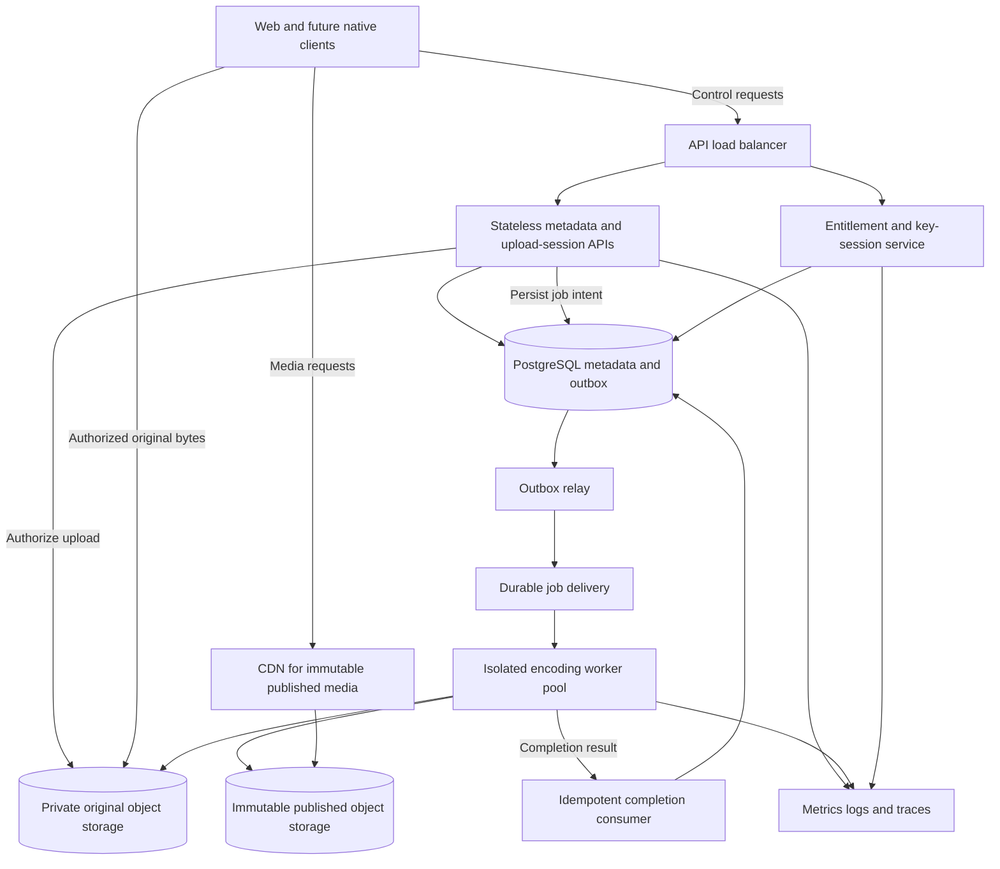
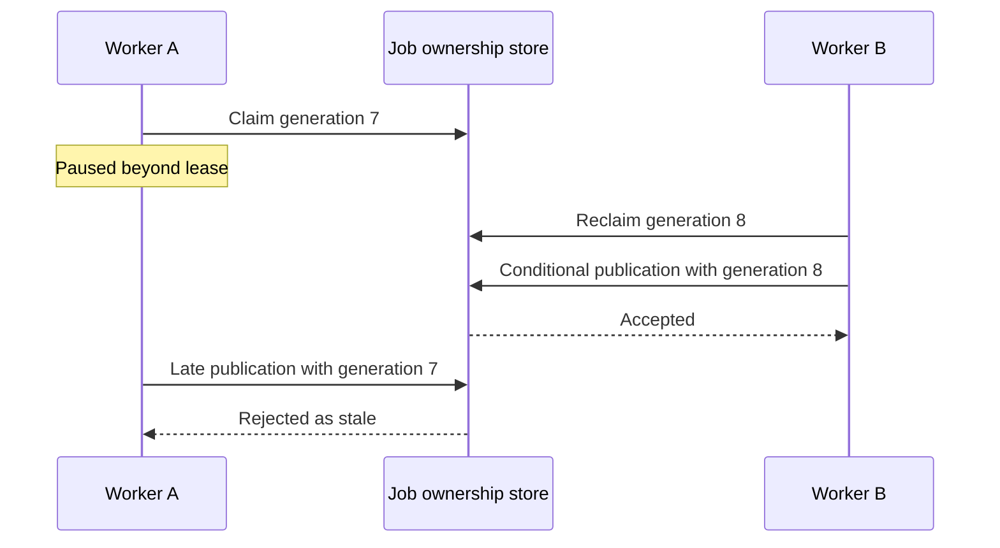
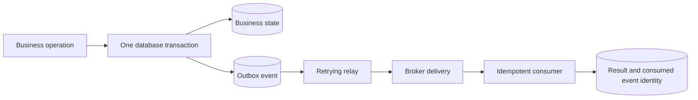

# 5. Scaling, distributed work, and operations

[Guide](../architecture.md) · [Previous](04-playback-and-security.md) · [Next: build and architecture labs](06-build-and-architecture-labs.md)

## What breaks when you start a second instance?

The current design deliberately runs one backend instance. H2 files, local media paths, synchronized methods, a local busy flag, and a local signing key are not a horizontal-scaling strategy. A second process cannot safely infer shared storage, job ownership, or shared signing policy from the existing interfaces.

Writing `leaseUntil` also does not establish a distributed lease protocol: the current worker has no cross-instance atomic claim, heartbeat loop, or fencing check on publication. Startup recovery assumes there are no other live owners. Preserve that deployment constraint until those mechanisms exist.

## Proposed deployment

This diagram is **a future architecture**, not infrastructure provisioned by this project.



The worker completion path still needs a durable result handoff and reconciliation; the arrow alone does not supply it. Store immutable output and completion intent durably, then redeliver or discover it until metadata publication commits. Do not acknowledge a broker job before that recovery path is established.

## Migrate one pressure at a time

### 1. Object storage and direct original uploads

Move original/output bytes behind a storage adapter before extracting every API into another service. A direct upload flow typically creates a session and authorized object key, uploads parts to object storage, then verifies the completed object's size/checksum and queues processing.

An object-created notification is not proof that a user completed the correct upload, nor a guarantee of exactly one notification. Correlate it with the expected session/object identity. Decide how abandoned multipart uploads are cleaned up.

[S3 presigned URLs](https://docs.aws.amazon.com/AmazonS3/latest/userguide/using-presigned-url.html) grant time-limited access to a particular operation/object using the signer's permissions. They are bearer capabilities; they can be reused before expiration, and writing an existing key can replace its object. Use unique scoped keys and explicit completion checks rather than treating a signed URL as one-time ownership proof.

Do not apply filesystem rename assumptions to object storage. Use immutable version keys and publish a committed pointer only after validating a complete artifact set. Copy-plus-delete is not a universal substitute for atomic rename.

### 2. PostgreSQL and explicit migrations

Migrate metadata with reviewed versioned migrations, backups, rollback/roll-forward strategy, and restore verification. A stronger schema does not automatically fix API authorization or worker ownership. Evaluate queries using representative data and plans before adding caches or sharding.

Offset pagination, substring search, fetching all queued rows, and per-segment database checks are reasonable points to investigate as load grows. An index, cursor, bounded queue claim, or CDN can address a particular access pattern; choose based on measured pressure.

### 3. Separate worker capacity

Keep HTTP instances responsive while encoding workers scale by CPU/memory/codec needs. Bound inflight work per worker. Scale with **oldest queue age and arrival/service rate**, not merely broker message count or API CPU. A queue of a hundred ten-second clips differs from a queue of a hundred hour-long 4K clips.

### 4. CDN and media origin

Serve immutable media through an origin/CDN path so cache hits do not run a JPA ready-state lookup per segment. Plan authorization, cache keys, geographic routing, origin protection, and invalidation together. Avoid forwarding unnecessary per-user cookies into shared media cache keys; protect key/session responses separately.

### 5. Replication and regions

Add availability zones and regions only after specifying the desired fault tolerance and data ownership. Regional latency, metadata replication lag, globally issued capabilities, signing-key distribution, and publication visibility all change. Database sharding requires a shard key and a strategy for cross-shard catalog/search queries; “shard the database” is not a complete design.

## Proposed atomic queue claims

For a modest distributed worker system, a PostgreSQL queue can be sufficient. This schema is **an independent learning example**, not a migration for the current `processing_jobs` table. Named parameters below are supplied by an application/SQL client.

```sql
CREATE TABLE encoding_jobs (
    id uuid PRIMARY KEY,
    video_id uuid NOT NULL,
    state text NOT NULL CHECK (state IN ('QUEUED','RUNNING','DONE','FAILED')),
    attempts integer NOT NULL DEFAULT 0,
    available_at timestamptz NOT NULL,
    lease_until timestamptz,
    lease_token bigint NOT NULL DEFAULT 0,
    claimed_by text
);

CREATE INDEX due_encoding_jobs ON encoding_jobs (available_at, id)
    WHERE state = 'QUEUED';

BEGIN;
WITH candidate AS (
    SELECT id
    FROM encoding_jobs
    WHERE state = 'QUEUED' AND available_at <= clock_timestamp()
    ORDER BY available_at, id
    LIMIT 1
    FOR UPDATE SKIP LOCKED
)
UPDATE encoding_jobs AS job
SET state = 'RUNNING',
    attempts = attempts + 1,
    lease_until = clock_timestamp() + interval '30 seconds',
    lease_token = lease_token + 1,
    claimed_by = :worker_id
FROM candidate
WHERE job.id = candidate.id
RETURNING job.*;
COMMIT;
```

Commit the claim before encoding. Do not hold the row lock while FFmpeg runs. `SKIP LOCKED` helps concurrent consumers avoid a locked candidate; it is a queue access pattern, not a consistency rule for normal business reads. See the [PostgreSQL SELECT locking documentation](https://www.postgresql.org/docs/current/sql-select.html#SQL-FOR-UPDATE-SHARE).

A heartbeat can conditionally extend a still-valid claim:

```sql
UPDATE encoding_jobs
SET lease_until = clock_timestamp() + interval '30 seconds'
WHERE id = :job_id
  AND state = 'RUNNING'
  AND claimed_by = :worker_id
  AND lease_token = :lease_token
  AND lease_until > clock_timestamp();
```

Zero updated rows means the worker no longer has valid ownership. It must not publish as if its claim were current. A reaper can requeue expired jobs with a bounded attempt/dead-letter policy; the next claim advances the token.

### Why a lease needs fencing

Worker A can pause longer than its lease, while worker B reclaims the job. A may later resume and finish successfully. Expiration did not kill A.



Use attempt-specific immutable object paths, then conditionally commit the selected publication pointer and completion intent in the database. Check token, owner, state, and validity in that same transaction. Updating only the job row conditionally is insufficient if an unrelated metadata update or object overwrite can still publish stale work.

## Proposed transactional outbox

The unsafe dual write is: commit a business change, then publish to a broker and hope both succeed. The proposed outbox puts business data and event intent in the same database transaction. A separate relay publishes committed events and records progress.



An example proposed envelope:

```json
{
  "eventId": "33333333-3333-4333-8333-333333333333",
  "type": "VideoPublicationReady",
  "schemaVersion": 1,
  "videoId": "22222222-2222-4222-8222-222222222222",
  "publicationVersion": "44444444-4444-4444-8444-444444444444",
  "jobId": "55555555-5555-4555-8555-555555555555",
  "leaseToken": 8,
  "occurredAt": "2026-10-21T10:00:00Z"
}
```

If the relay publishes and crashes before marking progress, it may publish again. The consumer should commit its business effect and consumed event identity together. Stable business publication identities also help when different envelopes refer to the same outcome. The [AWS outbox guidance](https://docs.aws.amazon.com/prescriptive-guidance/latest/cloud-design-patterns/transactional-outbox.html) discusses dual-write failure and duplicate delivery.

An outbox does not make object-store publication part of a database transaction. Keep the immutable artifact/descriptor reconciliation contract. Also decide event ordering, schema compatibility, retries, dead-letter handling, and redrive procedures.

## Observability tied to user outcomes

The following telemetry is **recommended to implement as an exercise**, not a set of existing dashboards:

- Upload success rate, acknowledged-byte throughput, resumed bytes avoided, checksum/conflict errors, and expired abandoned sessions.
- Queue oldest age, arrival/service rate, attempts, process timeouts, and terminal failures by structured code.
- Completion-to-READY and encoding-stage durations, with source duration/resolution buckets.
- Playback-start success and first-frame latency, rebuffer ratio, selected qualities, key rejection/renewal failures.
- Origin/CDN byte hit ratio, delivered bytes, storage growth, private-key read failures, and free working space.

Correlate requests/jobs with request ID, video ID, upload ID, job ID, attempt, and publication version. Keep bearer capabilities, cookies, key bytes, and private filesystem paths out of ordinary logs. Put high-cardinality identities in logs/traces, not unbounded metric labels.

Use percentiles and error rates per journey. An API returning 200 does not prove that a browser decoded a frame. A process exiting zero does not by itself prove a publication has every required artifact.

## Failure detection and runbooks

**Queue age rising:** check arrivals, active workers, due-job query health, CPU/memory, disk, and tool errors. Adding workers is unsafe until ownership is coordinated. In the current local runner, test what happens if the repository query throws after the busy flag is set; scheduler recovery is an important hardening exercise.

**Video stuck in processing:** inspect job state and attempts, then publication descriptor and completion event. If a valid publication already exists, reconcile it rather than deleting its key or starting blind re-encoding.

**Playback fails while catalog works:** separate manifest fetch, segment fetch, key fetch, decryption, and decoding. Check cookie scope/expiry and cache policy before changing the encoder. Verify a specific asset/version, not just the video title.

**Disk nearly full:** avoid accepting work that cannot finish. Budget incomplete uploads, originals, working output, and retained publications separately. Cleanup must never remove a key or artifact referenced by the selected publication.

**Restore after storage loss:** for the current local system, stop writes and back up/restore the entire data root coherently. A database backup without matching media, AES keys, and signing material is incomplete. Define RPO (acceptable lost changes) and RTO (acceptable outage), then prove them with a restore drill. Replication alone is not backup against accidental deletion.

## Architecture exercise

A region loses its metadata database but its CDN still has segments cached. Decide which existing and new viewing sessions can continue, where key authorization is available, and what the recovery policy is. Compare a longer session/key lifetime with a stronger revocation guarantee. Make the trade-off explicit rather than assuming every requirement can be maximized simultaneously.
